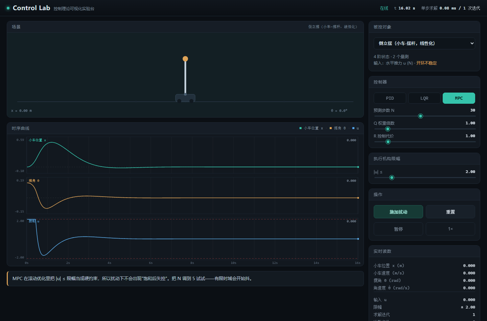
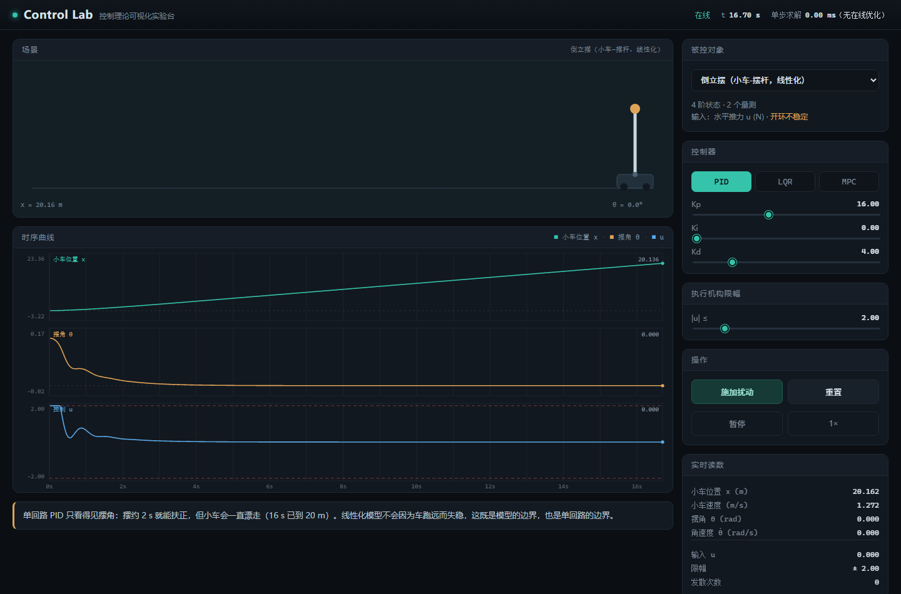
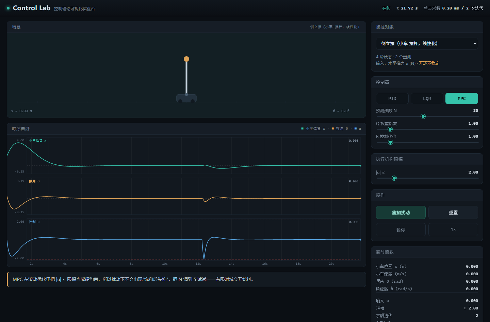

# Control Lab

**一个能动手的控制理论实验台：PID / LQR / MPC 在同一个扰动下，各自会怎么反应。**

打开浏览器，调参数、施加扰动，看曲线和倒立摆一起动。没有 MATLAB，没有 Simulink，`pip install` 两条命令就能跑。



---

## 为什么做这个

《自动控制原理》里 Riccati 方程和滚动优化通常停留在黑板公式上：会推、会算，但没见过它在一个真实闭环里长什么样。反过来，网上现成的仿真工具大多要许可证，或者只能给出结果曲线，看不到"约束、预测时域、权重"这些参数一动，闭环行为怎么变。

这个项目把三件事放在同一条时间轴上：

- **同一个被控对象**（倒立摆 / 双积分器 / 弹簧振子 / 直流电机），同一个初始状态；
- **三种控制器**随时切换，切过去时对象状态保留，可以直接看到交接瞬间；
- **每一个控制决策的开销都如实显示**——MPC 每步几次迭代、多少毫秒，不是"实时"两个字带过。

## 快速开始

```bash
git clone <your-repo-url>
cd control-lab
python -m venv .venv
# Windows: .venv\Scripts\activate      macOS/Linux: source .venv/bin/activate
pip install -r requirements.txt
python run.py
```

浏览器会自动打开 <http://127.0.0.1:8000/>。没有前端构建步骤，改完 `web/` 里的文件刷新即可。

跑测试（20 项检查，不需要 pytest）：

```bash
python tests/test_core.py
```

## 界面上有什么

| 区域 | 内容 |
|---|---|
| 场景 | 倒立摆的实时动画，包含推力方向箭头、倾角弧线 |
| 时序曲线 | 每个信号一个独立子图（位置、角度、控制量），控制量子图上画出限幅线 |
| 控制器 | PID / LQR / MPC 一键切换，参数滑杆实时生效 |
| 执行机构限幅 | 拖动 `|u| ≤` 立刻改变闭环行为，用来复现"饱和" |
| 操作 | 施加扰动（给小车一个力脉冲）、重置、暂停、0.5×–4× 倍速 |

右上角常驻显示**单步求解耗时和迭代次数**——这是判断 MPC 是否真的在算，还是只是画了个动画的地方。

## 一个具体的对比

同样从 θ = 0.15 rad 的初始倾斜出发，三种控制器跑 16 秒：

| | 摆角 θ | 小车位置 x | 控制量 |
|---|---|---|---|
| **PID**（只看角度） | 约 2 s 回到 0 | **漂到 20 m 且仍在加速** | 饱和后回落 |
| **LQR**（全状态反馈） | 回到 0 | 回到 0 | 从不越限 |
| **MPC**（带约束优化） | 回到 0 | 回到 0 | 从不越限，且每步 1–12 次迭代 |



这张图是项目的核心论点：**单回路 PID 没有"小车在哪"这个概念**，它能看见的只有角度，于是把角度调好就成了唯一目标。这不是 PID 调得不好，是结构决定的。

> 需要说清楚：倒立摆是**线性化模型**，小车跑到 20 m 时这个模型其实早就失效了。所以这张图证明的是"单回路只盯着一个量"这个结构性缺陷，不是"PID 在真实台架上一定会这样"。真实装置里小车会跑出导轨，然后一切结束。

扰动下 MPC 的表现：



## 内置对象

| 对象 | 阶数 | 特征 |
|---|---|---|
| 倒立摆（小车-摆杆） | 4 | 开环不稳定，极点约 ±5.4 rad/s，倒下的倍增时间约 0.13 s |
| 双积分器 | 2 | 无阻尼纯积分，考验阻尼设计 |
| 弹簧-质量-阻尼 | 2 | 欠阻尼振子，ω ≈ 1 rad/s |
| 直流电机（位置伺服） | 2 | 一阶速度滞后 + 位置积分 |

所有模型都以连续状态空间形式写在 `core/models.py`，系数可以直接对照教材核验。

## 算法实现

全部自己实现，只依赖 NumPy——这样每个数字都能追溯到一行代码，而不是"某个库算的"。

**离散化** `core/linalg.py::expm`
增广矩阵 `[[A, B], [0, 0]]` 做矩阵指数。缩放-平方 + 20 阶泰勒，双精度下误差约 1e-15。

**Riccati 方程** `core/linalg.py::dare`
值迭代求 `P`，收敛后重算增益 `K`，保证 `P` 和 `K` 自洽。不可稳的 (A,B) 对会抛异常而不是返回垃圾——测试里专门验证了这一点。

**box 约束 QP** `core/qp.py`
ADMM，分裂成"光滑二次部分"和"盒约束"：

```
x-更新 : (P + ρI) x = ρ(z − u) − q
z-更新 : z = clip(x + u, lb, ub)
u-更新 : u = u + x − z
```

`P + ρI` 在 MPC 里是常量，所以 Cholesky 分解只做一次，每步控制只需要几次三角回代。这是 MPC 单步能压到 0.1 ms 量级的原因。

**MPC** `core/controllers.py`
condensed 形式：预测状态 `X = F·x₀ + G·U`，于是 `H = G'QG + R̄` 是常量，只有线性项 `q = G'Q(F·x)` 随状态变化。终端代价用 LQR 的 `P`，这让预测时域只有 0.6 s 时闭环依然稳。

**warm start**：上一拍的解右移一位作为下一步 QP 的初值。迭代次数从冷启动的数十次降到个位数，界面上能看到这个数。

**观测器**（可选，默认关闭）
Luenberger 增益由对偶 Riccati 求出：对 `(A', C')` 解一次 DARE。开启后测量噪声不再直接进入控制器。

## 验证

```
$ python tests/test_core.py
  PASS  test_expm_matches_known_values
  PASS  test_discretisation_preserves_eigenvalues
  PASS  test_dare_satisfies_the_riccati_equation
  PASS  test_lqr_closed_loop_is_stable
  PASS  test_dare_reports_failure_on_unstabilisable_pair
  PASS  test_box_qp_interior_solution
  PASS  test_box_qp_respects_and_activates_bounds
  PASS  test_box_qp_mixed_active_set
  PASS  test_box_qp_scales_to_a_control_horizon
  PASS  test_box_qp_handles_a_fixed_variable
  PASS  test_lqr_stabilises_the_cart_pole
  PASS  test_mpc_stabilises_the_cart_pole_within_the_input_bound
  PASS  test_pid_holds_the_angle_but_loses_the_cart
  PASS  test_mpc_tracks_a_reference_on_the_double_integrator
  PASS  test_simulation_stream_shape_and_bounds
  PASS  test_simulation_survives_a_hostile_configuration
  PASS  test_observer_converges_under_measurement_noise
  PASS  test_disturbance_pulse_decays
  ...
all 20 checks passed
```

几条值得单独说明的检查：

- **QP 的 KKT 条件**被逐坐标验证，不只是"解看起来合理"。包括混合活跃集、上下界相等的固定变量、30 维控制时域问题。
- **PID 的"失败"被写成了断言**（`test_pid_holds_the_angle_but_loses_the_cart`）：摆角必须收敛、小车必须漂走。哪天这个行为变了，测试会立刻告诉你演示的前提被动摇了。
- **发散保护**被验证：故意给一个反向增益的 PID，仿真应记录发散次数并重置，而不是把 `NaN` 灌进数据流。

## 已知限制

写出来是为了不被误用：

1. **倒立摆是线性化模型**，只在 θ ≈ 0 附近有效。小车跑到 20 m 那张图，物理上已经不成立。
2. **MPC 只有输入硬约束**（QP 求解器是 box 型）。状态约束、软约束还没做——想加的话需要换成能处理一般线性不等式的 QP（Dykstra 投影或内点法）。
3. **没有多输入多输出耦合**。所有对象都是单输入，分支没有 `MIMO`。
4. **观测器没有界面开关**，只能在 `Simulation` 的配置里打开。
5. **仿真不是硬实时的**：Python 单进程、50 Hz 控制频率。卡顿时会丢弃模拟时间而不是追帧（`MAX_STEPS` 上限）。

## 目录结构

```
control-lab/
├── core/                 # 纯算法，不依赖 Web 框架
│   ├── linalg.py         # expm、DARE
│   ├── models.py         # 四个被控对象 + ZOH 离散化
│   ├── controllers.py    # PID / LQR / MPC
│   └── qp.py             # box-QP（ADMM）
├── server/
│   ├── engine.py         # 一个仿真会话
│   └── app.py            # FastAPI + WebSocket
├── web/                  # 无构建步骤的前端
│   ├── index.html
│   ├── app.js
│   └── style.css
├── tools/
│   └── screenshot.py     # 用 headless Chrome 复现 docs/ 里的图
└── tests/
    └── test_core.py      # 20 项自检
```

`core` 完全不认识 FastAPI，可以单独 `import` 出来做离线仿真：

```python
from core.models import get_plant
from core.controllers import build_controller

plant = get_plant("inverted_pendulum")
ctrl = build_controller("mpc", plant, 0.02, {"horizon": 30})
Ad, Bd, _, _ = plant.discrete(0.02)

x = plant.x0
for _ in range(500):
    u, info = ctrl.compute(x, [0.0, 0.0])
    x = Ad @ x + Bd @ u
print(f"求解 {info['solve_ms']:.2f} ms / {info['iters']} 次迭代")
```

## Roadmap

- [ ] 一般线性状态约束（Dykstra 投影版本的 ADMM）
- [ ] 观测器与噪声的界面开关
- [ ] 双输入对象（例如带横向力的四旋翼简化模型）
- [ ] 记录/回放一次会话的参数与轨迹，便于对比两次调参
- [ ] 把 `dare` 换成结构化迭代，处理高维稀疏系统

## License

MIT
